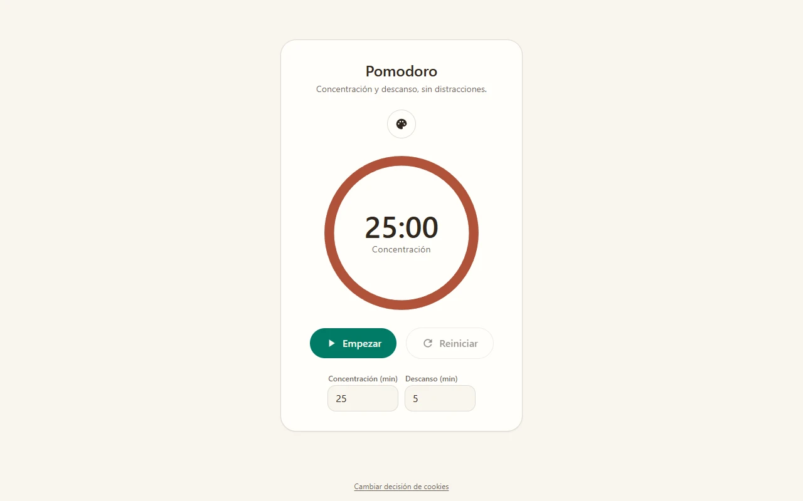
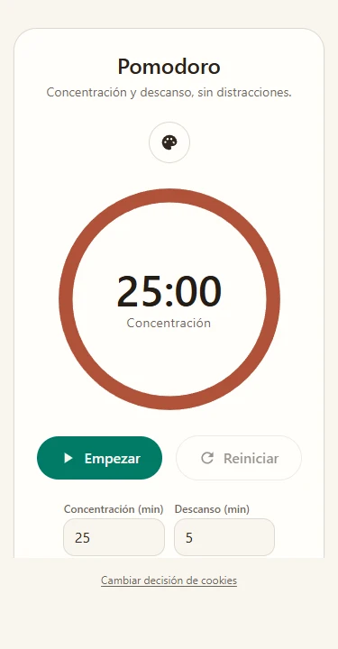
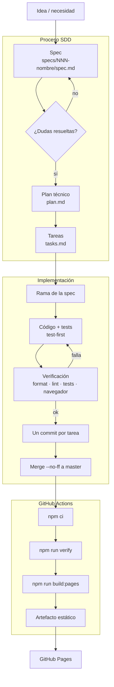

# Simple Pomodoro

**Concentración y descanso, sin distracciones.**

[](https://github.com/JoseMiguel92/simple-pomodoro/actions/workflows/publish.yml)


Aplicación web de un temporizador Pomodoro para mantener la concentración: fases de trabajo y descanso que se alternan solas, un dial que se vacía segundo a segundo y cuatro paletas para elegir el ambiente.

**[Abrir la app →](https://josemiguel92.github.io/simple-pomodoro/)**

## Capturas

| Escritorio                                                                            | Móvil                                                                        |
| ------------------------------------------------------------------------------------- | ---------------------------------------------------------------------------- |
|  |  |

## Características

- **Temporizador Pomodoro** de concentración y descanso, con tiempos editables de 1 a 60 minutos (25/5 por defecto).
- **Alternancia automática** entre fases, con tarjeta de aviso y pitido al terminar cada una.
- **Conteo preciso**: cada segundo se muestra una sola vez, sin saltos ni deriva, también en Firefox.
- **Dial SVG** que se vacía al ritmo de la fase actual.
- **Cuatro paletas**: Sereno (por defecto), Noche, Atardecer y Bosque.
- **Consentimiento claro**: si rechazas el almacenamiento no se guardan ajustes ni progreso, y puedes cambiar la decisión desde el pie de la página.
- **Responsive** y usable con teclado, con foco visible en todos los controles.

## Cómo usarla

1. Abre <https://josemiguel92.github.io/simple-pomodoro/>.
2. Elige si quieres guardar tus ajustes en el navegador.
3. Ajusta los minutos de concentración y descanso, pulsa **Empezar** y deja que el temporizador haga el resto.

El progreso se mantiene al recargar la página (si has aceptado el almacenamiento) y cada fase nueva avisa con una tarjeta y un pitido.

## Desarrollo local

Requisitos: **Node.js 24** (probado con 24.16.0) y npm 11. El proyecto usa el gestor de paquetes indicado en `packageManager`.

```bash
npm install
npm start
```

La app queda disponible en <http://localhost:4200/>. `npm install` también instala los hooks de git (husky).

## Scripts

| Comando                 | Qué hace                                                                   |
| ----------------------- | -------------------------------------------------------------------------- |
| `npm start`             | Servidor de desarrollo en <http://localhost:4200/> con recarga al guardar. |
| `npm run build`         | Build de producción en `dist/`.                                            |
| `npm run build:pages`   | Build de producción para GitHub Pages (base href `/simple-pomodoro/`).     |
| `npm run watch`         | Build en modo watch con la configuración de desarrollo.                    |
| `npm run verify`        | Formato + lint + tests; es la verificación completa del proyecto.          |
| `npm run test:run`      | Tests una sola vez.                                                        |
| `npm test`              | Tests en modo watch.                                                       |
| `npm run test:coverage` | Tests con informe de cobertura (mínimo 90 % en la lógica).                 |
| `npm run lint`          | Calidad del código con ESLint.                                             |
| `npm run format`        | Formatea todos los ficheros con Prettier.                                  |
| `npm run format:check`  | Comprueba el formato sin modificar nada.                                   |

## Proceso de desarrollo (SDD)

Cada funcionalidad nace como una **spec** en `specs/NNN-nombre/`, se revisa, se convierte en un plan técnico y se reparte en tareas. La implementación sigue tests primero, se verifica en el navegador y se integra con un merge `--no-ff`; la publicación es automática.



Las reglas innegociables del proyecto están en [`docs/constitution.md`](docs/constitution.md) y las convenciones de trabajo en [`AGENTS.md`](AGENTS.md).

## Despliegue

La web se publica en <https://josemiguel92.github.io/simple-pomodoro/> al hacer push a `master`, mediante [`.github/workflows/publish.yml`](.github/workflows/publish.yml):

1. GitHub Actions instala las dependencias con `npm ci`.
2. Ejecuta `npm run verify` (formato, lint y tests); si falla, no se publica.
3. Construye con `npm run build:pages` y sube `dist/simple-pomodoro/browser` como artefacto.
4. El artefacto se despliega en GitHub Pages.

Requisito, una sola vez: en _Settings → Pages_, configurar el origen como **GitHub Actions**.

## Stack

- **Angular 22** con TypeScript y Vite.
- **Tailwind CSS 4** (CSS-first, tokens `@theme`).
- **Vitest** con `@vitest/coverage-v8` para los tests.
- **Prettier**, **ESLint**, **husky** y **lint-staged** para la calidad del código.

## Estructura del proyecto

```text
src/app/
  timer/       temporizador, dial, controles, avisos y persistencia
  consent/     diálogo y pie de consentimiento
  palette/     selector y lógica de las paletas
specs/         una carpeta por funcionalidad (spec, plan y tareas)
docs/          constitución y documentación del proyecto
.github/       workflow de publicación en GitHub Pages
```

## Documentación

- [Constitución del proyecto](docs/constitution.md)
- [Convenciones de trabajo](AGENTS.md)
- [Specs](specs/)
- [Memoria del proyecto](MEMORY.md)
